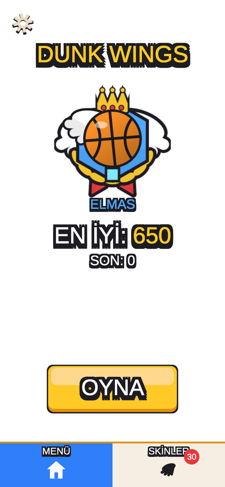
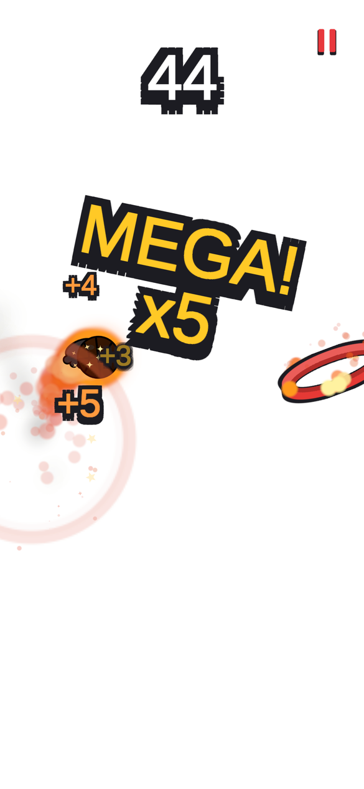
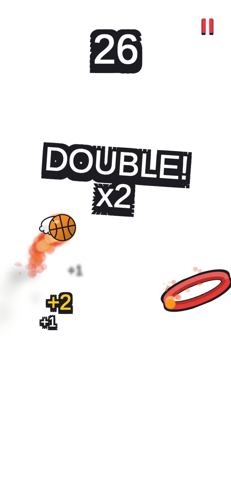
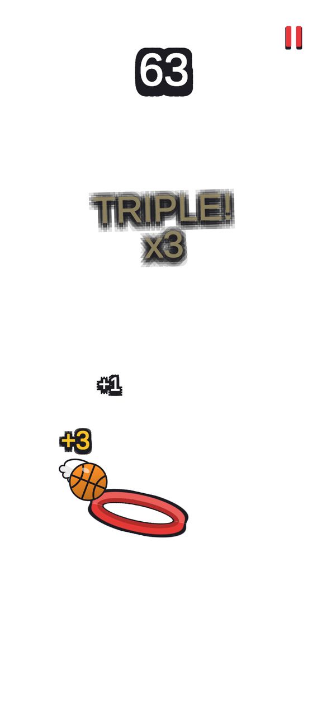
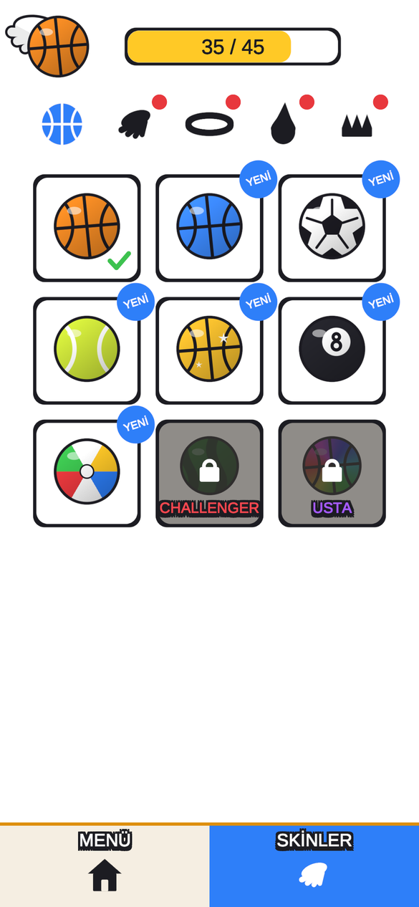
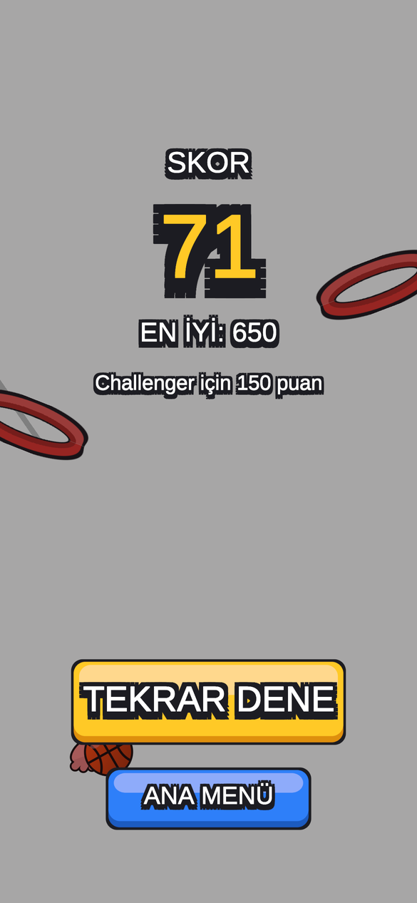

<h1 align="center">Dunk Wings</h1>

<b>Tap-to-fly basketball arcade game for iOS and Android</b> Unity 6 · C#

## About

Tap to flap a winged basketball through scrolling hoops. Drop through a hoop without touching the rim and you start a **swish combo**: DOUBLE ×2, TRIPLE ×3, ULTRA ×4, MEGA ×5 … From the fourth swish in a row the ball catches fire, turns black and crackles.

- **Endless, easy-to-hard difficulty:** smaller rings, tilted rings, rings sliding on visible tracks and rocking rings
- **Game feel:** flame trails, burning hoops, explosions with shockwaves and sparks, screen shake, a full spin when the ball bounces off the rim, slow-motion when it rattles on the rim
- **Haptics on every basket** (Taptic Engine on iOS, amplitude vibration on Android)
- **8 leagues** from Noob to Master, each unlocking new skins; **45 skins** in 5 categories (ball, wings, hoop, flame, hat)
- **8 languages**, first-game tutorial, local reminder notifications
- No coins, no shop, no ads

## How it's built

- **Unity 6 (URP 2D), C#**, everything built from code: the scene is empty and the app creates the world and UI at runtime
- **No art files:** every sprite (ball, wings, hoops, hats, flames, league badges, icons) is drawn procedurally from signed-distance functions; all sounds are synthesized
- **Pure, unit-tested game rules** (scoring, combo, leagues, hoop generator, skin unlocks) in an engine-free assembly, covered by NUnit tests
- Custom pooled particle system with zero per-frame allocations
- Native iOS haptics plugin (Objective-C) and Android `VibrationEffect` through JNI
- Firebase Analytics + Crashlytics, Unity Mobile Notifications

> Source code is private. This repository is a showcase.
